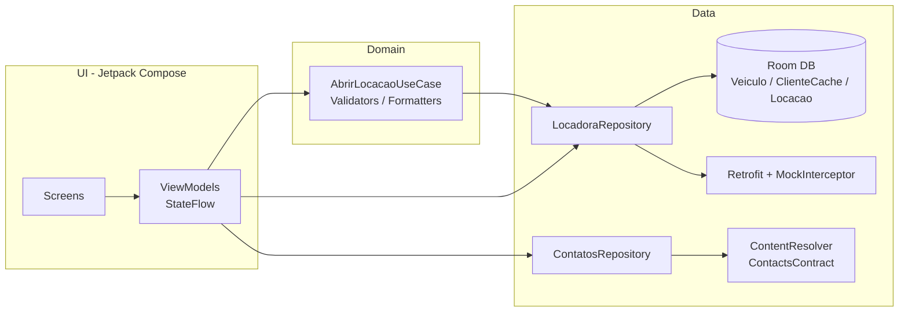

# Locadora — App Android para pequenos locadores de veículos

Aplicativo Android nativo (Kotlin + Jetpack Compose) para gerenciar a frota, buscar clientes
na agenda de contatos do aparelho e controlar locações ativas.

## Funcionalidades

- **Dashboard (tela inicial):** lista somente locações `ATIVA` com veículo (marca, modelo, placa),
  cliente (nome, telefone), datas `dd/MM/yyyy`, dias faltantes (calculado dinamicamente) e destaque
  visual para locações em atraso. FAB "Nova locação".
- **Frota:** listagem com status (Disponível / Alugado / Manutenção) e cadastro de veículos com
  validação de placa (AAA-1234 ou Mercosul AAA1A23), diária positiva e todos os campos obrigatórios.
- **Contatos:** permissão `READ_CONTACTS` em runtime (com tratamento de negação e "tentar novamente"),
  leitura via `ContentResolver`/`ContactsContract` e filtro por nome em tempo real.
- **Nova locação:** só veículos `DISPONIVEL`, cliente vindo dos contatos, `DatePicker` para as datas,
  total estimado (dias × diária). Ao confirmar, a locação é salva como `ATIVA`, o veículo vira
  `ALUGADO` (em uma única transação do Room) e o app volta ao Dashboard.
- **Sincronização (Retrofit):** botão de sincronizar no Dashboard usa Retrofit 2 com um
  `MockInterceptor` (API simulada) para baixar veículos e enviar locações.

## Arquitetura

MVVM com separação em camadas **UI → Domain → Data**.



- **Room:** 3 tabelas (`veiculos`, `clientes_cache`, `locacoes`) com `@ForeignKey`;
  POJO `LocacaoDetalhe` com `@Embedded` + `@Relation`.
- **Estado:** `StateFlow` nos ViewModels e `collectAsStateWithLifecycle()` na UI;
  estados de Carregando / Vazio / Erro via `UiState`.
- **Navigation Compose** em Single Activity; o contato escolhido volta para a tela de nova
  locação via `SavedStateHandle`.
- **Assincronismo:** Coroutines + Flow (Room, Retrofit e ContentResolver).
- **DI:** manual, via `AppContainer` (sem bibliotecas extras).

## Como compilar e executar

Requisitos: Android Studio (Ladybug ou mais novo) e JDK 17.

1. Clone o repositório e abra a pasta no Android Studio.
2. Aguarde o sync do Gradle.
3. Execute em um emulador/aparelho com Android 8.0+ (API 26+).

Pela linha de comando:

```bash
./gradlew assembleDebug     # APK em app/build/outputs/apk/debug/
./gradlew assembleRelease   # APK em app/build/outputs/apk/release/
```

### APK pelo GitHub

O workflow `.github/workflows/build.yml` compila o projeto a cada push. O APK fica disponível em
**Actions → Build APK → Artifacts**. Ao criar uma tag `v1.0` (ex.: `git tag v1.0 && git push --tags`),
o APK também é anexado na aba **Releases**.

> Dica para testar a busca de contatos no emulador: adicione alguns contatos com telefone no app Contatos.

## Capturas de tela

| Dashboard | Frota | Novo veículo |
|-----------|-------|--------------|
|  |  |  |

| Permissão de contatos | Busca de contatos | Nova locação |
|-----------------------|-------------------|--------------|
|  |  |  |

## Estrutura

```
app/src/main/java/com/locadora/app/
├── data/        # Room (entities, DAOs), Retrofit (API + mock), repositórios
├── domain/      # Caso de uso, validadores, formatadores
├── ui/          # Compose: dashboard, veiculos, contatos, locacao, navegação, tema
├── AppContainer.kt / LocadoraApp.kt / MainActivity.kt
```
